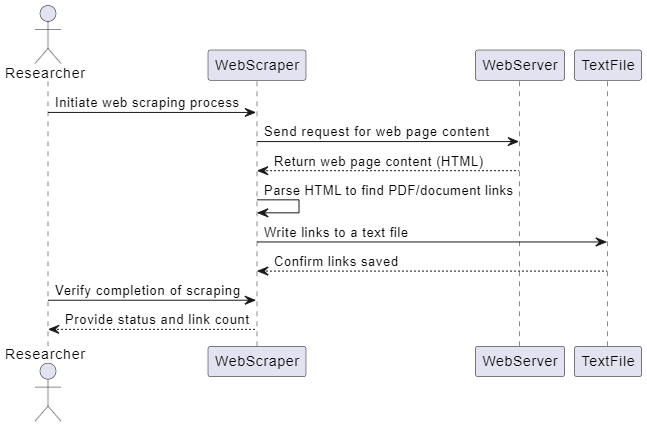
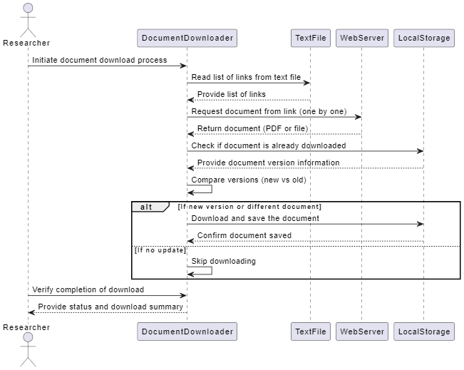

# Design Document

## Components

1. Generating URLs

   * Identifying list resource weblinks
   * Webscraping and collecting links to documents
   * Save the links to text file
     
1. Downloading latest documents

   * Loading the links from text file
   * Downloading documents from servers if new
     
1. Extracting and storing vectorDB

   * Parsing documents for latest information on tenders
   * Updating latest information to VectorDB
1. Quering DB using LLM

   * Querying DB with user defined query
   * Parsing results
   * Generating reports
1. Automatic updating VectorDB

   * Automate the process
   * Downloading documents to storing into VectorDB
